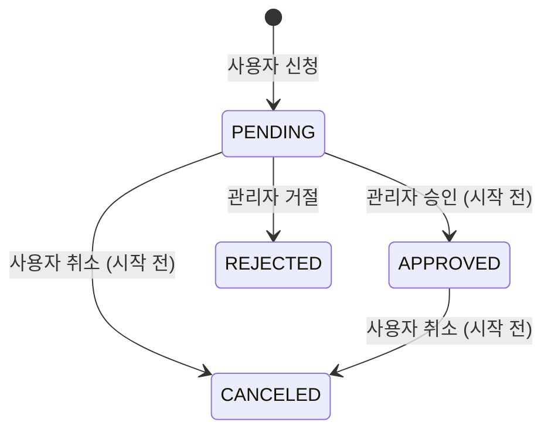

# 회의실 예약 시스템

사내 회의실을 예약하고, 관리자가 승인하는 웹 서비스입니다.
**MyBatis 기반의 일반적인 웹 서비스**에서 회원·권한·트랜잭션을 어떻게 다루는지 보여주는 것을 목표로 만들었습니다.

핵심은 **같은 회의실·같은 시간에 여러 명이 동시에 신청해도 중복 예약이 생기지 않게 하는 것**이고,
이를 실제 MySQL 위에서 멀티스레드 테스트로 검증했습니다.

## 기술 스택

| 구분 | 사용 기술 |
|---|---|
| 언어 / 빌드 | Java 17, Gradle |
| 프레임워크 | Spring Boot 3.3.5, Spring MVC, Spring Security 6 |
| 데이터 접근 | MyBatis 3 (XML 매퍼), MySQL 8.4 (Docker) |
| 화면 | Thymeleaf + JSP/JSTL (함께 사용) |
| 기타 | Bean Validation, Lombok, JUnit 5, MockMvc |
| 패키징 | 실행형 war |

## 주요 기능

| 사용자 (USER) | 관리자 (ADMIN) |
|---|---|
| 회원가입, 로그인/로그아웃 | 회의실 등록·수정·비활성화·재활성화 |
| 회의실 목록 조회 | 예약 승인·거절 (상태별 목록) |
| 예약 신청 (30분 단위, 최대 4시간) | |
| 내 예약 목록, 예약 취소 | |

### 예약 상태 흐름



- **PENDING과 APPROVED**는 시간을 차지합니다. 같은 시간에 다른 사람이 신청할 수 없습니다.
- **REJECTED와 CANCELED**는 시간을 비워줍니다.

## 핵심 설계

### 1. 동시 신청: room 행 잠금 (`SELECT ... FOR UPDATE`)

"겹치는 예약이 있는지 조회 → 없으면 저장"을 그냥 실행하면, 두 요청이 동시에 조회를 통과해서 둘 다 저장될 수 있습니다.
그래서 예약 신청은 트랜잭션 안에서 **회의실(room) 행을 먼저 잠근 뒤** 겹침을 검사합니다.

```
[ReservationService.create]  @Transactional
 1. 시간 규칙 검사 (30분 단위, 최대 4시간, 과거 불가)   ← DB를 쓰지 않으므로 잠금 전에
 2. SELECT ... FROM room WHERE id = ? FOR UPDATE      ← 같은 회의실 신청은 여기서 한 줄로 선다
 3. 비활성 회의실이면 거부
 4. 겹치는 PENDING/APPROVED 예약이 있으면 거부
 5. INSERT (status = PENDING)
```

- **잠금 단위를 회의실로 잡은 이유**: 예약 테이블에서 겹치는 범위를 잠그면 갭 락 때문에 교착 상태가 생기기 쉽습니다. 회의실 행 하나를 잠그면 규칙이 단순하고, 다른 회의실끼리는 서로 기다리지 않습니다.
- **잠금이 반드시 첫 쿼리여야 하는 이유**: MySQL 기본 격리 수준(REPEATABLE READ)은 트랜잭션의 첫 일반 SELECT 시점에 스냅샷을 만듭니다. 잠금보다 먼저 조회하면, 앞 트랜잭션이 커밋한 예약을 겹침 검사에서 보지 못합니다.
- **회의실 비활성화도 같은 room 행을 먼저 잠급니다.** 그래서 "예약 신청"과 "비활성화"가 동시에 와도 비활성 회의실에 예약이 남지 않습니다.

### 2. 상태 변경: 조건부 UPDATE

취소·승인·거절은 상태 확인과 변경을 **SQL 한 문장**으로 처리합니다.

```sql
UPDATE reservation SET status = 'APPROVED'
WHERE id = ? AND status = 'PENDING' AND start_time > ?
```

바뀐 행 수가 0이면 조건이 맞지 않거나 다른 요청이 먼저 바꾼 것이므로 거부합니다.
승인(PENDING → APPROVED)은 두 상태 모두 시간을 차지해서 겹침 결과가 바뀌지 않고, 취소·거절은 시간을 비워줄 뿐이라 **room 잠금이 필요 없습니다.**

### 3. 동시성 테스트로 검증

`ReservationConcurrencyTest`는 실제 MySQL에서 `CountDownLatch`로 여러 스레드를 동시에 출발시킵니다.
잠금(또는 조건)을 일부러 빼고 돌려서, **테스트가 실제로 문제를 잡아내는지**도 확인했습니다.

| 상황 | 잠금/조건 있음 | 잠금/조건을 뺐을 때 |
|---|---|---|
| 같은 시간에 8명이 동시에 신청 | 1건만 성공 | **3건 성공 (중복 예약)** |
| 예약 신청과 회의실 비활성화가 동시에 들어옴 (20회) | 항상 정상 | **비활성 회의실에 예약이 남음** |
| 사용자 취소와 관리자 승인이 동시에 들어옴 (20회) | 취소가 항상 유지됨 | **취소가 승인으로 덮어써짐** |

### 4. 권한과 보안

- **URL 권한**: `/admin/**`는 ADMIN만 접근할 수 있고, 나머지 화면은 로그인한 사용자만 접근할 수 있습니다.
- **신청자 정보**: 신청자 id는 폼으로 받지 않고 로그인 정보(`@AuthenticationPrincipal`)에서 꺼냅니다. 폼에 다른 사람의 id를 넣어도 무시됩니다.
- **남의 예약 취소**: 403이 아니라 **404**로 응답합니다. 403을 주면 그 예약이 존재한다는 사실이 드러나기 때문입니다.
- **로그인 실패 메시지**: "아이디가 없음"과 "비밀번호가 틀림"을 같은 메시지로 보여줍니다. 가입된 아이디를 알아낼 수 없게 하기 위해서입니다.
- **비밀번호**: BCrypt 해시로 저장하고, DB 비밀번호는 환경변수(`DB_PASSWORD`)로만 받습니다.
- **CSRF**: 상태를 바꾸는 요청은 모두 POST이고 CSRF 토큰을 검사합니다.
- **XSS**: JSP는 `<c:out>`과 Spring 폼 태그, Thymeleaf는 `th:text`로 출력값을 이스케이프합니다.

### 5. Thymeleaf와 JSP를 함께 쓰는 구성

공공·SI 환경에서 많이 쓰는 JSP를 직접 다뤄보기 위해 두 방식을 함께 썼습니다.

- **JSP**: 회의실 목록, 예약 신청, 내 예약, 관리자 예약 관리
- **Thymeleaf**: 회원가입, 로그인, 홈, 관리자 회의실 관리

- **war 패키징**: 내장 Tomcat은 실행형 jar 안의 JSP를 지원하지 않아서 war로 패키징합니다.
- **뷰 리졸버 순서**: Thymeleaf 뷰 리졸버가 먼저 실행되므로, JSP 화면 이름은 `spring.thymeleaf.excluded-view-names`로 제외합니다.
- **Spring Security forward 허용**: Security 6은 컨트롤러에서 JSP로 넘기는 forward 요청도 권한을 검사합니다. 그래서 `FORWARD`와 `ERROR` 디스패치를 허용합니다.
- **JSP 작성 규칙**: 스크립틀릿(`<% %>`) 없이 EL과 JSTL만 사용합니다.

## 테이블

```
member      (id, login_id[UNIQUE], password[BCrypt], name, role[USER/ADMIN], created_at)
room        (id, name[UNIQUE], location, capacity, active, created_at)        -- 삭제하지 않고 active = 0
reservation (id, member_id[FK], room_id[FK], start_time, end_time, purpose,
             status[PENDING/APPROVED/REJECTED/CANCELED], created_at, updated_at)
```

전체 스키마는 [schema.sql](src/main/resources/schema.sql)에 있습니다.
겹침 판정은 `기존.start_time < 새.end_time AND 기존.end_time > 새.start_time`입니다.
그래서 10:00~11:00과 11:00~12:00처럼 경계가 맞닿는 예약은 허용됩니다.

## 프로젝트 구조

```
src/main/java/com/example/reservation
├── controller   요청 처리, 화면 이동만 (비즈니스 로직 없음)
├── service      트랜잭션, 예약 규칙, 잠금
├── mapper       MyBatis 매퍼 인터페이스
├── domain       테이블과 대응하는 객체 (Member, Room, Reservation)
├── dto          화면 입력값/출력값 (Form, View)
├── security     로그인 회원(UserDetails), 회원 조회
├── exception    규칙 위반 예외
└── config       Spring Security 설정
src/main/resources
├── mapper/      MyBatis XML (SQL)
├── templates/   Thymeleaf 화면
└── schema.sql
src/main/webapp/WEB-INF/views/   JSP 화면
```

## 실행 방법

### 1. MySQL 준비 (Docker)

```bash
docker run -d --name reservation-db -p 3306:3306 \
  -e MYSQL_ROOT_PASSWORD=<비밀번호> -e MYSQL_DATABASE=reservation -e TZ=Asia/Seoul mysql:8
```

테이블을 만듭니다. 테스트용 DB(`reservation_test`)도 같은 스키마로 만들어 둡니다.

```bash
docker exec -i reservation-db mysql -uroot -p<비밀번호> --default-character-set=utf8mb4 reservation < src/main/resources/schema.sql
docker exec reservation-db mysql -uroot -p<비밀번호> -e "CREATE DATABASE reservation_test DEFAULT CHARACTER SET utf8mb4"
docker exec -i reservation-db mysql -uroot -p<비밀번호> --default-character-set=utf8mb4 reservation_test < src/main/resources/schema.sql
```

### 2. 실행

DB 비밀번호는 환경변수 `DB_PASSWORD`로 넘깁니다. IntelliJ에서 실행한다면 실행 구성의 환경 변수에 넣습니다.

```bash
export DB_PASSWORD=<비밀번호>
./gradlew bootWar
java -jar build/libs/reservation-0.0.1-SNAPSHOT.war
```

http://localhost:8080 으로 접속한 뒤 회원가입부터 시작합니다.
관리자 계정은 가입 후 DB에서 권한을 바꿉니다.

```sql
UPDATE member SET role = 'ADMIN' WHERE login_id = '<아이디>';
```

### 3. 테스트

```bash
export DB_PASSWORD=<비밀번호>
./gradlew test
```

테스트 97개는 실제 MySQL의 `reservation_test` DB에서 실행됩니다. 각 테스트는 끝나면 롤백되고, 동시성 테스트는 만든 데이터를 직접 지웁니다.

| 테스트 | 검증 내용 |
|---|---|
| `ReservationServiceTest` | 겹침 경계값(완전히 겹침, 일부 겹침, 포함, 경계가 맞닿음), 상태별 겹침 여부, 비활성 회의실 |
| `ReservationConcurrencyTest` | 동시 신청, 신청과 비활성화, 취소와 승인 (멀티스레드) |
| `ReservationCancelTest`, `ReservationApprovalTest` | 상태 변경 규칙 |
| `ReservationTimeRuleTest` | 30분 단위, 최대 4시간, 과거 불가 (DB 없이) |
| `*ControllerTest`, `*IntegrationTest` | 로그인 필요, USER/ADMIN 권한, CSRF, 남의 예약 404 |
